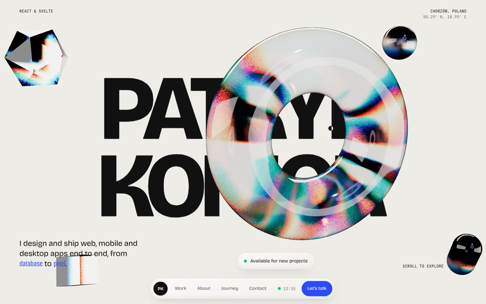
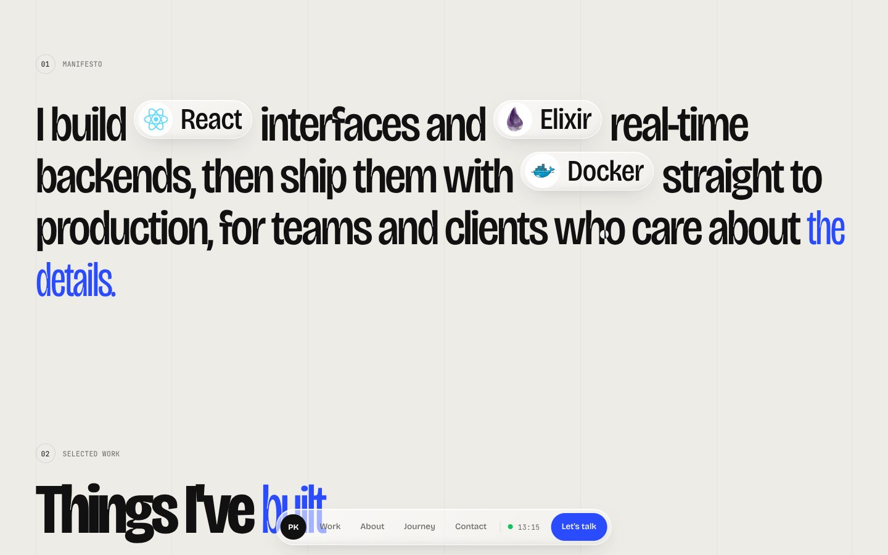
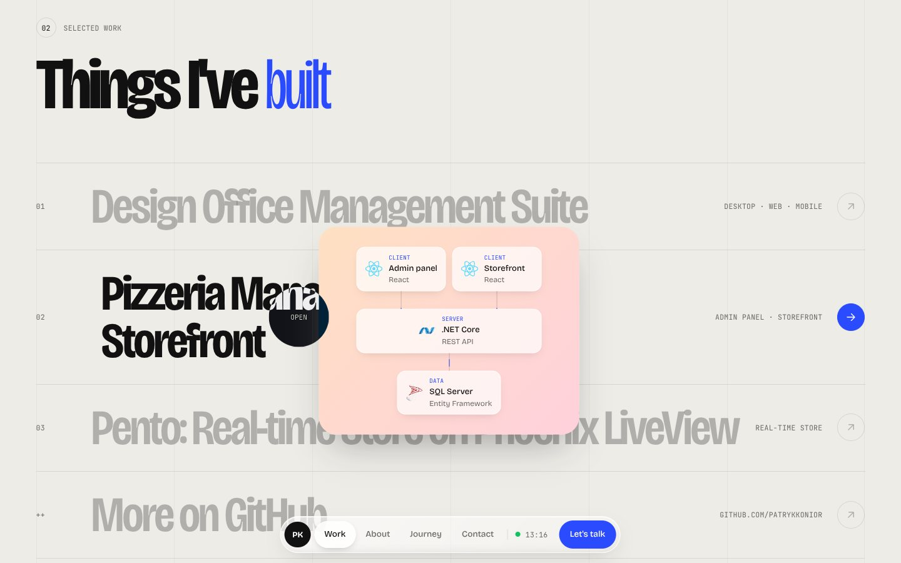
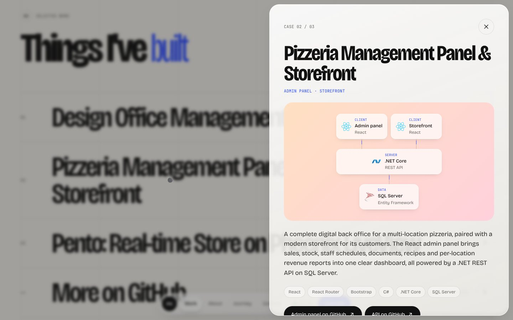
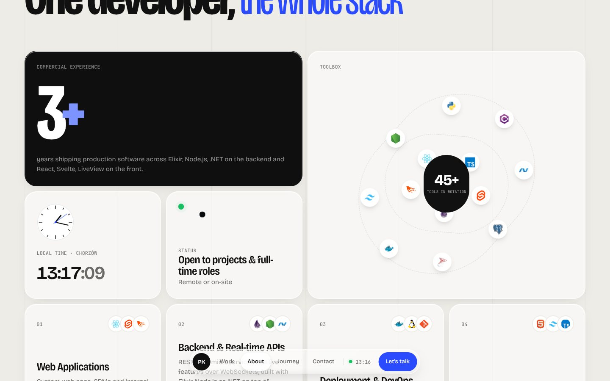
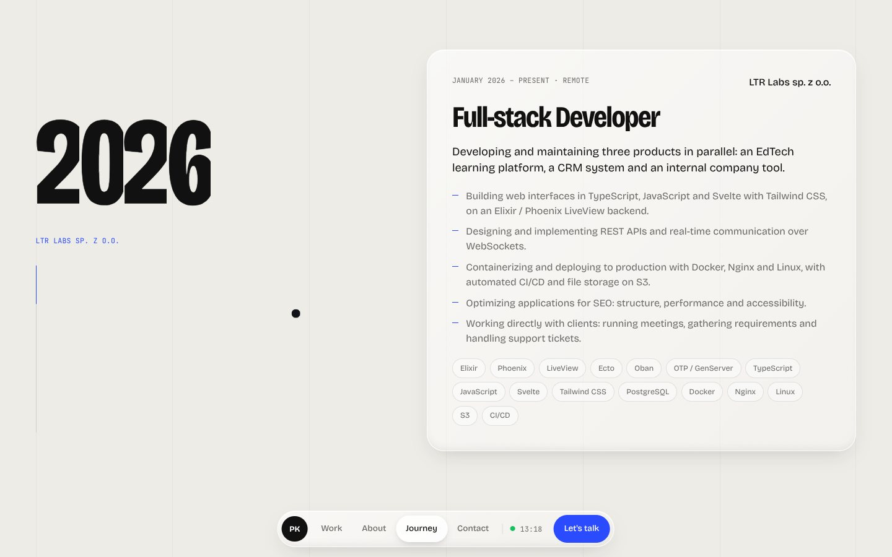
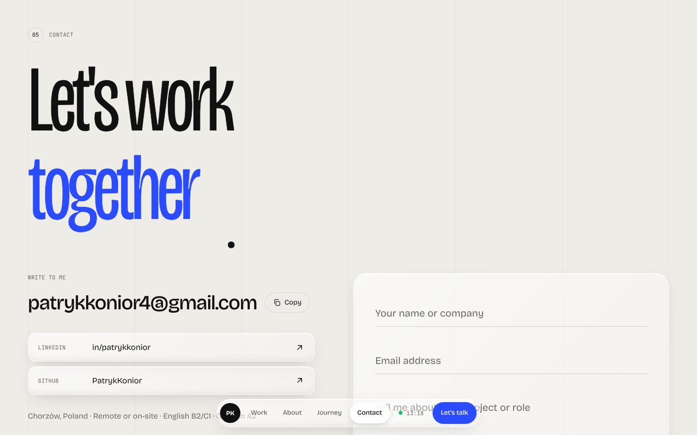

# Liquid Glass — Portfolio Concept

An experimental, light-themed take on my developer portfolio, built around the liquid-glass trend: my name is rendered in WebGL and bent by refractive glass shapes with chromatic aberration, and the interface floats on frosted-glass surfaces.

It's a design and front-end study that sits alongside my main portfolio ([Portfolio_2027](https://github.com/PatrykKonior/Portfolio_2027)), exploring a completely different visual direction with the same content.



## Highlights

- **Refractive WebGL hero.** The name is drawn in 3D and seen through a glass torus that follows the pointer, plus floating crystals that drift apart on scroll (React Three Fiber, drei `MeshTransmissionMaterial`). The scene stops rendering once it's off screen.
- **Floating glass dock** for navigation, with an elastic indicator that follows the active or hovered section.
- **Manifesto** with inline tech pills, revealed word by word from blur as you scroll.
- **Typographic project index** with a pointer-following preview card and a case-study drawer.
- **Bento grid** with 3D tilt and spotlight, a live analog clock and an orbiting toolbox.
- **Journey timeline** with a sticky odometer year that rolls to each role.
- **Variable-font contact headline** whose letters swell in weight and width near the pointer.
- Lenis smooth scrolling synced with GSAP ScrollTrigger, and graceful fallbacks for `prefers-reduced-motion`.

| | |
|---|---|
|  |  |
|  |  |
|  |  |

## Stack

React 19 · Vite · Three.js / React Three Fiber · drei · GSAP (ScrollTrigger, SplitText) · Lenis · Tailwind CSS 4 · EmailJS

## Run it

```bash
npm install
npm run dev      # local dev server
npm run build    # production build in dist/
```

The contact form uses EmailJS: copy `.env.example` to `.env` and fill in the `VITE_APP_EMAILJS_*` keys.

Content (projects, services, experience) lives in `src/constants/index.js`.

---

Made by [Patryk Konior](https://github.com/PatrykKonior) · [LinkedIn](https://www.linkedin.com/in/patrykkonior/)
